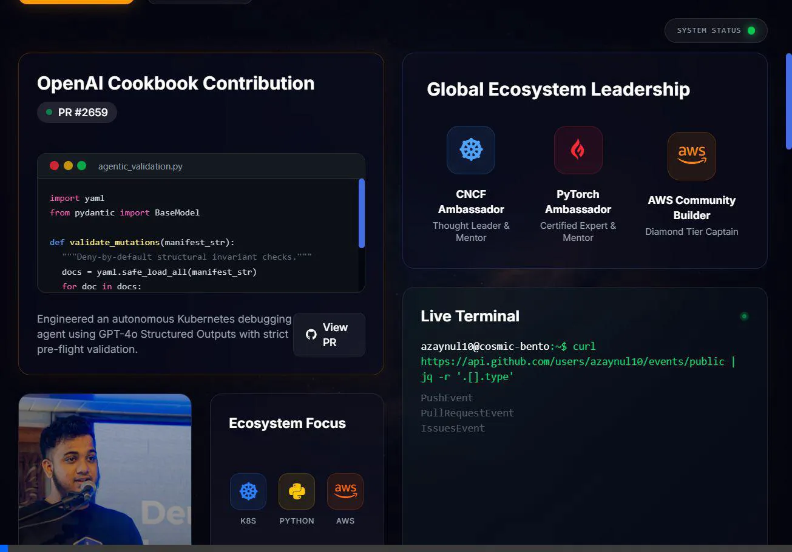

# Zaynul Abedin Miah — Agentic AI & Cloud Native Portfolio



## Purpose

A high-performance, SEO-optimized personal portfolio showcasing cloud-native engineering, agentic AI projects, and developer community leadership across Bangladesh. Built with a "Cosmic Bento" aesthetic featuring deep space-black glassmorphic cards, multi-layer parallax starfields, and holographic micro-animations.

## Tech Stack

| Layer | Technology |
|-------|-----------|
| **Framework** | React 19 + Vite 8 |
| **Styling** | Tailwind CSS v4 |
| **Routing** | React Router DOM v7 |
| **Icons** | FontAwesome 6 & Lucide-React |
| **Forms** | Formspree |
| **Hosting** | Vercel (CI/CD Pipeline) |

## SEO Features

- **Structured Data**: JSON-LD `ProfilePage` + `Person` schema for Google rich results
- **Meta Tags**: Open Graph (Facebook/LinkedIn), Twitter/X card metadata
- **Sitemap**: Generated from `scripts/seo-routes.mjs`
- **Robots**: `robots.txt` with sitemap reference
- **Canonical URLs**: Per-page canonical tags via `SEOHead` component
- **Multi-Page Architecture**: Dedicated SEO-optimized pages for each project, community chapter, and workshop
- **Rendered HTML**: The production build renders each React route, including lazy pages, so page content and internal links are available before JavaScript runs.
- **Missing pages**: Unknown URLs use a noindex 404 page rather than returning the homepage.

## Featured Projects

| Project | Tech | Page |
|---------|------|------|
| **Kube-AutoFix** | OpenAI, Kubernetes, MLflow, Databricks | [/projects/kube-autofix](/projects/kube-autofix-autonomous-kubernetes-sre-agent) |
| **Transnational AQMS** | Google ADK, PyTorch, IoT | [/projects/air-quality](/projects/transnational-air-quality-ai-agent) |
| **IAN Accessibility** | Gemini Vision, Cloud Run, TTS | [/projects/ian](/projects/intelligent-accessibility-navigator) |
| **MLflow Observability** | MLflow, Databricks, Python | [/projects/mlflow](/projects/mlflow-agent-observability-databricks) |

## Local Development

```bash
# Clone
git clone https://github.com/azaynul10/visual-journey.git
cd visual-journey

# Install
npm install

# Dev server
npm run dev

# Production build
npm run build
```

## Deployment

This site deploys automatically to **Vercel** on push to `main`. The build writes
`index.html`, route-specific `.html` files, and `404.html`. Vercel's `cleanUrls`
serves the route files without extensions; there is no catch-all homepage rewrite.
In-app navigation still uses React Router, and the browser hydrates the rendered HTML.

Recent speaking entries live in `src/components/RecentTalks.jsx`. The optimized
photos in `public/images/talks/` come from the organizer's real event files:
`RBB00050.JPG` (GitHub Dev Days, EXIF date 1 October 2026),
`1793545991393.jpeg` (Notion teaching slide/signage), and
`presenting_torchtpu-slide.jpg` (TorchTPU presentation). Originals remain outside
the repo; the web copies are resized/compressed, with the Notion photo's side
borders cropped. The AIUB GITAI Campusverse image comes from `DSC00357 (1).jpg`;
its full frame, including the organizer's existing photo marks, is retained.
The AIUB Computer Club recap verifies the event date as 13 April 2026:
https://aiubcc.org/gitai-campusverse/. No audience gallery or generated event
photo is added.

The recent-talks section uses a horizontal scroll-snap carousel. It supports
swipe/trackpad scrolling, previous/next buttons, slide selectors, Left/Right and
Home/End keys when the viewport is focused, and direct talk hash links. There is
no autoplay or vertical-scroll takeover; reduced-motion preferences disable
smooth programmatic scrolling. All four talk entries remain in the rendered HTML.

**Recommended GitHub Topics:**
`portfolio` `developer-portfolio` `react` `vite` `tailwindcss` `cloud-native` `agentic-ai` `personal-branding`

## 🤝 Contact

- Email: [zaynulabedinmiah10@gmail.com](mailto:zaynulabedinmiah10@gmail.com)
- LinkedIn: [zaynul-abedin-miah](https://www.linkedin.com/in/zaynul-abedin-miah/)
- GitHub: [@azaynul10](https://github.com/azaynul10)
